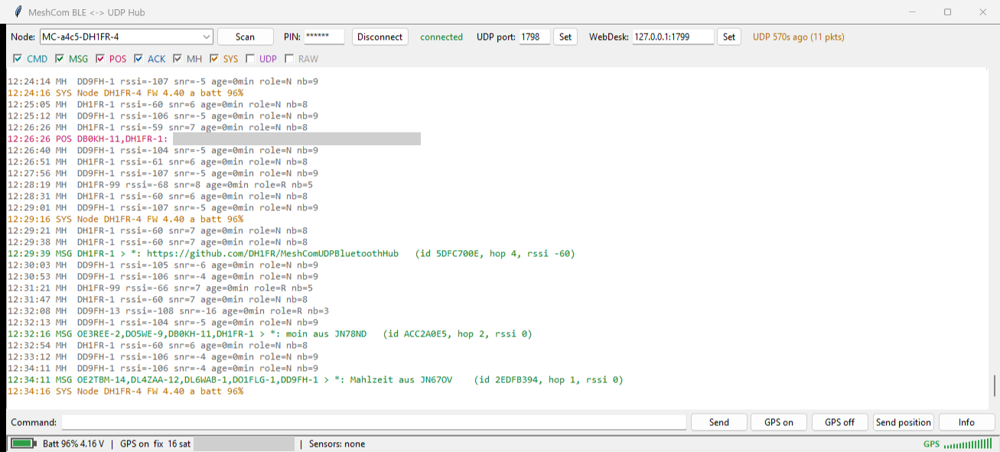

# MeshCom UDP Bluetooth Hub

[English version → README.md](README.md)

Ein kleines Gateway, das sich wie die Handy-App per **Bluetooth LE** mit einem
[MeshCom](https://github.com/icssw-org/MeshCom-Firmware)-Node verbindet und sich gegenüber
[MeshcomWebDesk](https://github.com/DH1FR/MeshcomWebDesk) als Node mit **Ext-UDP-Schnittstelle** und
**NET Console** ausgibt.

## Warum es das gibt

Ich habe einen **Heltec T114** (nRF52840). Er hat weder WLAN noch Ethernet, deshalb gibt es auf ihm
weder die Ext-UDP-Schnittstelle (UDP 1799) noch die NET Console (TCP 2323) der Firmware. WebDesk
spricht nur diese beiden Netzwerkschnittstellen und kam deshalb nicht an den Node heran. Bluetooth hat
der T114 aber, und die Handy-App zeigt, dass der Node darüber alles liefert. Dieser Hub schlägt die
Brücke:

```
 MeshcomWebDesk ──UDP/JSON──►  Hub (PC / Raspberry Pi)  ──BLE──►  Node (z. B. Heltec T114)
  (Ext-UDP, NET Console)  ◄──                            ◄──
```

Genauso nützlich ist er mit **jedem anderen MeshCom-Node mit Bluetooth** (Heltec V3/V4, T-Beam,
RAK4631, ...), wenn man kein WLAN nutzen kann oder will: unterwegs, im Hotel, portabel oder weil der
Node nicht ins eigene Netz soll. Hinweise:

- **Nur mit dem Heltec T114 getestet** (Firmware 4.40a). Andere Nodes nutzen dasselbe BLE-Protokoll
  und sollten funktionieren, das ist aber eine Annahme.
- Sensor-Telemetrie von Nodes mit Sensoren geht an WebDesk, ist aber ungetestet (der T114 hat keine).
- Ein Node bedient **jeweils einen BLE-Client**: Solange der Hub verbunden ist, kann die Handy-App den Node nicht nutzen.
- Der Hub ist **kein Internet-Gateway**. Nachrichten laufen weiter über LoRa zu einem Gateway in Reichweite.

> Inoffizielles Community-Projekt, nicht mit dem MeshCom-Projekt oder dem Autor von WebDesk
> verbunden. Gebaut gegen die MeshCom-Firmware **4.40a**.



*Das Hub-Fenster: oben Node, UDP-Port und WebDesk-Adresse, in der Mitte das Log, unten die Statusleiste mit Akku, GPS und Satelliten (eigene Position und die Position einer fremden Station geschwärzt).*

## Funktionen

- Nachrichten in beide Richtungen, mit Echo des Nodes und Zustellquittungen (die Haken in WebDesk)
- Positionen (`pos`) und Sensor-Telemetrie (`tele`) gehörter Stationen
- Emulation der WebDesk-**NET Console** (HMAC-SHA256-Challenge/Response wie in der Firmware)
  - `--help` beantwortet der Hub mit einer kurzen Befehlsliste und einem Hinweis (der Node gibt seine Hilfe nur über USB aus)
  - `--mheard` / `--mh` werden aus den BLE-MH-Frames des Nodes beantwortet, im `[MH] key=value`-Format der Firmware
  - `--info` und `--pos` werden aus den BLE-Statusframes des Nodes beantwortet (die Firmware gibt sie nur über USB aus)
  - andere `--Befehle` gehen per BLE an den Node (siehe Einschränkungen)
- Optionales Monitor-Fenster (`--gui`): Node aus einer Liste der Nodes in der Nähe wählen, Live-Anzeige von
  Nachrichten, Positionen, Quittungen und MHeard, Befehlszeile, Knöpfe für *GPS an/aus* und *Position senden*
- Statusleiste: Batteriesymbol mit Füllstand, GPS-Status, Satelliten (Balkenanzeige), eigene Position und Sensorwerte
- Die eigene Position und, falls der Node Sensoren hat, seine eigene Telemetrie gehen an WebDesk (`src_type: "node"`)
- Beide UDP-Ports sind im Fenster sichtbar und ohne Neustart änderbar: **UDP port** (Port, auf dem der Hub
  lauscht, in WebDesk „Device Port“) und **WebDesk** (IP:Port, an den der Hub sendet, in WebDesk „Listen Port“)
- Merkt sich Node, PIN und die Adresse von WebDesk
- Läuft unter **Windows** (WinRT) und **Linux / Raspberry Pi** (BlueZ) über [bleak](https://github.com/hbldh/bleak)

## Voraussetzungen

- Python 3.10+
- `pip install -r requirements.txt` (nur `bleak`)
- Ein Bluetooth-LE-Adapter. Unter Linux/Raspberry Pi muss BlueZ laufen; für das Fenster
  `sudo apt install python3-tk`
- Ein MeshCom-Node mit BLE, Firmware 4.40a (andere 4.x-Versionen sind ungetestet)

## Schnellstart

```
pip install -r requirements.txt
python hub.py --gui
```

Im Fenster den Node wählen (Namen wie `MC-xxxx-CALL`), die BLE-PIN eintragen und **Connect** drücken.
**Vorher die Handy-App trennen** – der Node nimmt nur einen BLE-Client an.

Ohne Fenster:

```
python hub.py --name MC-a4c5 --pin 123456
```

(`--name` ist ein Teil des BLE-Namens, `--address` nimmt die BLE-Adresse; beides überspringt die Auswahl.)

### Einstellungen in WebDesk

WebDesk läuft auf demselben PC (oder zeigt auf die IP des Hubs):

| WebDesk-Einstellung | Wert |
|---|---|
| Device IP | `127.0.0.1` (oder IP des Hubs) |
| Device Port | `1798` (UDP-Port des Hubs) |
| Listen IP / Listen Port | `127.0.0.1` / `1799` |
| Rufzeichen | **das Rufzeichen des Nodes** (z. B. `DH1FR-4`) |
| KISS/TCP | aus |
| NET Console | aktiv, Device IP wie oben, Port `2323` |

Hinweise:

- WebDesk belegt UDP 1799 selbst, deshalb nutzt der Hub standardmäßig **1798**, wenn beide auf einem PC laufen.
- Das Rufzeichen in WebDesk **muss zum Node passen**. Sonst erkennt WebDesk das Echo der eigenen Nachrichten
  nicht und zeigt ein Warndreieck.
- Der Hub lernt die Adresse von WebDesk aus dessen Paketen und speichert sie; sie steht im Feld **WebDesk** im
  Fenster und lässt sich dort ändern. Bis zum ersten Paket sendet er an `127.0.0.1:1799` (`--peer` ändert das).

## Optionen

| Option | Bedeutung |
|---|---|
| `--gui` | Monitor-Fenster mit Node-Auswahl |
| `--name TEXT` / `--address ADR` | Node per (Teil des) BLE-Namens / per Adresse |
| `--pin N` | BLE-PIN des Nodes (App-Layer-Hello) |
| `--udp-port N` | UDP-Port des Hubs (Standard 1799; neben WebDesk auf demselben PC 1798) |
| `--peer IP:PORT` | wo WebDesk lauscht, bis es sich anmeldet |
| `--console-port N` | TCP-Port der NET Console (Standard 2323, `0` = aus) |
| `--console-host IP` | Bind-Adresse (Standard `127.0.0.1`) |
| `--console-password PW` | NET-Console-Passwort (HMAC); leer = offen, nur lokal |

Im Fenster gewählte Einstellungen landen in `hub_config.json` (siehe `hub_config.example.json`).
Diese Datei enthält die PIN im Klartext und ist per `.gitignore` ausgeschlossen.

## Einschränkungen

- **Konsolenausgabe:** Die Firmware schickt nur einen Teil der Befehlsantworten über BLE. `--help`, `--info`
  und die meisten Textausgaben gehen nur an die serielle USB-Schnittstelle und erscheinen deshalb nicht in der
  NET Console. `--help` beantwortet der Hub selbst mit einer kurzen Liste und diesem Hinweis. `--mheard` beantwortet der Hub aus den MH-Frames; es enthält **keine Positionen**
  (`lat/lon/alt = NA`).
- RSSI/SNR von Nachrichten und Positionen stammen aus dem letzten MHeard-Eintrag der Station (0, wenn
  unbekannt); die BLE-Frames tragen sie nicht.
- Die Satellitenbalken zeigen nur die Anzahl der Satelliten und den Fix; der Node schickt keine
  Satellitendetails (Sky Plot) über Bluetooth.
- Telemetrie von WebDesk zum Node ist nicht möglich: Die Firmware nimmt diese Werte nur über ihr eigenes
  ext-UDP an, und Bluetooth kennt keinen Befehl, der sie setzt.
- Die eigene Telemetrie des Nodes ist umgesetzt, aber ungetestet: der T114 hat keine Sensoren.
- Nur ein BLE-Client gleichzeitig (Handy-App **oder** Hub).
- Getestet mit Heltec T114, Firmware 4.40a, Windows 11. Auf einem Raspberry Pi noch nicht getestet.

## Sicherheit

- Die NET Console lauscht nur auf `127.0.0.1`, solange du `--console-host` nicht setzt. Eine nicht lokale
  Adresse wird **ohne `--console-password` abgelehnt**, denn die Konsole kann jeden Befehl auf dem Node
  ausführen (auch Neustart).
- Der UDP-Port lauscht auf allen Schnittstellen; nutze eine Firewall, wenn der PC in einem fremden Netz hängt.
- Ext-UDP selbst hat in der Firmware ebenfalls keine Authentifizierung.

## Funktionsweise (kurz)

- BLE: Nordic-UART-Service. Der Hub sendet das App-Layer-Hello (`0x10`, SHA-256 der 6-stelligen PIN) und die
  Zeit (`0x20`); der Node antwortet mit Konfiguration, MH-Liste und später Live-Frames.
- Node → Hub: `0x40`-Frames tragen Nachrichten im APRS-Stil (`0x3A`), Positionen (`0x21`) und Quittungen
  (`0x41`); `0x44`-Frames tragen JSON (Konfiguration, MH).
- Hub → WebDesk: dasselbe JSON, das die Firmware auf ihrem Ext-UDP-Port sendet (`msg`, `pos`, `tele`, `ack`).
- WebDesk → Node: `msg` wird zu einem BLE-Textframe (`0xA0`); Text, der mit `--` beginnt, läuft als Konsolenbefehl.

## Lizenz

© 2026 Ralf Altenbrand (DH1FR) · Alle Rechte vorbehalten. Kostenlos für **lizenzierte Funkamateure** zur
**privaten, nichtkommerziellen Nutzung**; kommerzielle Nutzung nur mit schriftlicher Genehmigung. Gleiche
Bedingungen wie MeshcomWebDesk. Ohne Gewährleistung, Benutzung **auf eigene Gefahr**. Siehe [LICENSE](LICENSE).

## Danksagung

[MeshCom-Firmware](https://github.com/icssw-org/MeshCom-Firmware) (Protokollvorlage) und
[MeshcomWebDesk](https://github.com/DH1FR/MeshcomWebDesk) (der Client, für den dieser Hub gebaut wurde).
Verwendete Protokolle, Tabellen und Abhängigkeiten stehen in [NOTICE.md](NOTICE.md), samt MIT-Lizenztext
der MeshCom-Firmware.
